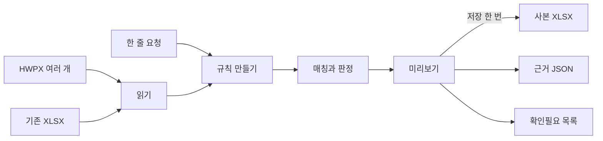
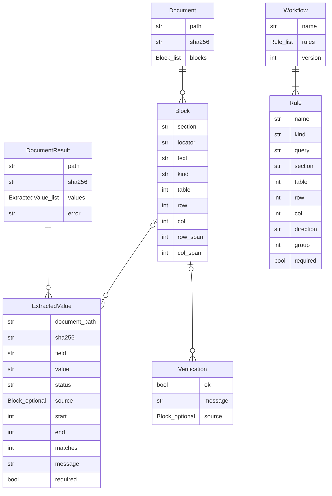
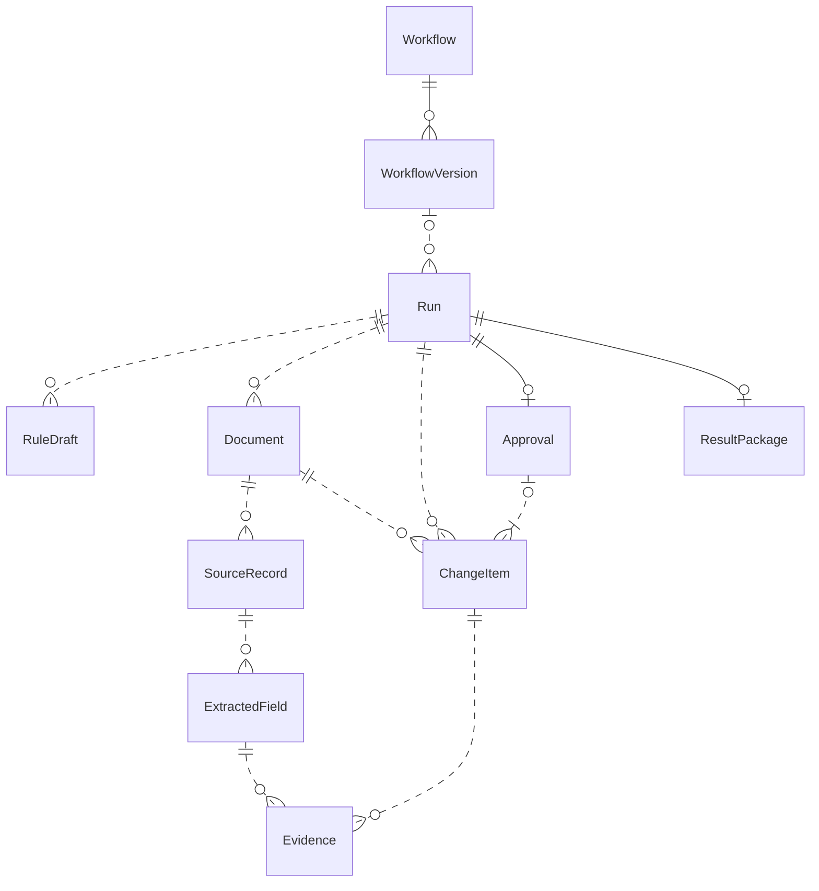
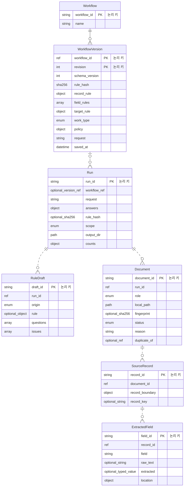
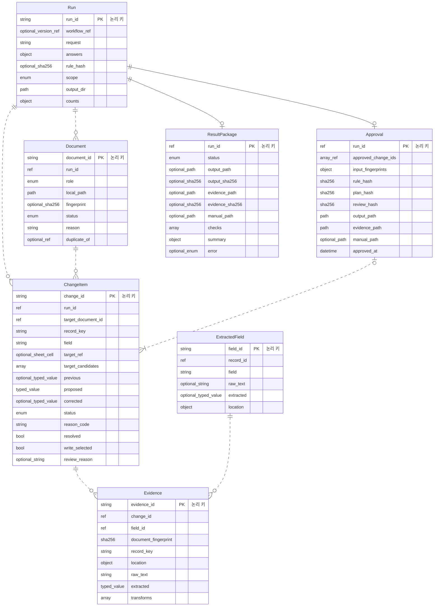
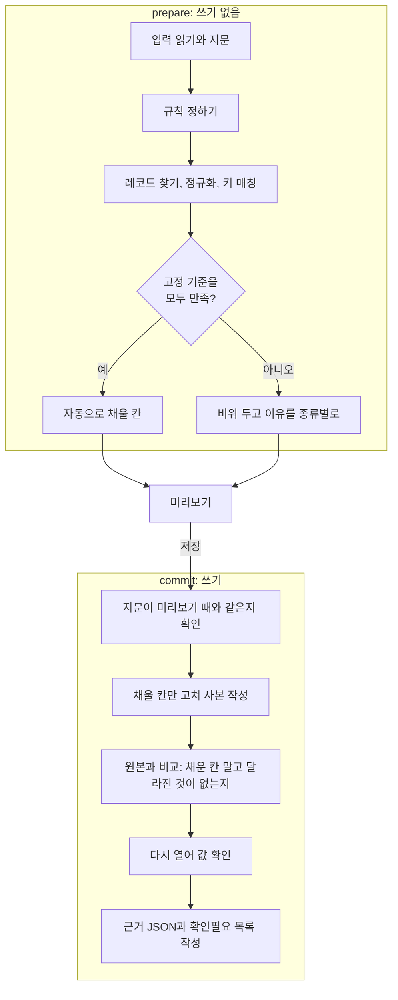

# 구조

이 문서는 우렁각시가 어떤 부품으로 이루어져 있고 데이터가 어떻게 흐르는지 설명한다. 무엇을 만드는지는 [requirements.md](requirements.md), 함수 단위의 계약은 [api.md](api.md)에 있다.

**상태 표기:** `현재`는 지금 코드에 있는 것이고, `목표`는 설계는 확정됐지만 아직 구현하지 않은 것이다. 목표를 구현된 기능으로 읽으면 안 된다.

## 1. 한눈에

- 인터넷 없이 한 대의 PC에서 도는 데스크톱 앱이다. 서버와 데이터베이스가 없다.
- `현재`: 여러 HWPX 문서에서 값을 뽑아 새 XLSX로 취합하고, 값마다 원본 위치를 남긴다.
- `목표`: 한 줄 요청으로 HWPX의 값을 **이미 있는 XLSX 취합표의 사본**에 채우거나 대조한다. 확실한 칸만 자동으로 채우고, 애매한 칸은 비워 둔 채 이유를 종류별로 알려 준다.

## 2. 설계 원칙

| 원칙 | 뜻 | 막으려는 것 | 상태 |
|---|---|---|---|
| 계산과 부작용의 분리 | 읽기·판정·계획은 입력을 받아 새 값을 돌려주는 함수다. 파일 쓰기는 마지막 한 곳에서만 한다 | 계산 도중 파일이 반쯤 바뀌는 상태 | `현재` 읽기·추출, `목표` 계획·저장 |
| 불변 데이터 | 문서·규칙·계획은 만든 뒤 바꾸지 않는 객체다 | 미리보기에서 본 것과 저장되는 것이 달라지는 일 | `현재` 문서·규칙, `목표` 계획 |
| 원본을 건드리지 않음 | 입력 파일은 읽기만 한다. 결과는 항상 새 파일이다 | 원본 훼손 | `현재` |
| 본 것만 저장 | 저장할 때 입력 파일과 계획의 지문(SHA-256)이 미리보기 때와 같은지 확인한다 | 확인한 뒤 파일이 바뀐 채 저장되는 일 | `목표` |
| 고정 기준으로 자동 처리 | 자동으로 채우는 조건은 코드에 고정된 검사다. AI의 자신감 점수를 쓰지 않는다 | 그럴듯하지만 틀린 값의 자동 입력 | `목표` |
| AI는 고르기만 | 로컬 모델은 "어느 칸, 어느 열인지"만 고르고, 규칙은 코드가 만든다 | 모델이 쓴 규칙이 그대로 실행되는 일 | `목표` |
| 네트워크 없음 | 실행 중 인터넷 소켓과 DNS를 막는다 | 문서 내용의 외부 전송 | `현재` |

## 3. 현재 구현

### 3.1 모듈

| 파일 (`src/ureonggaksi/`) | 책임 |
|---|---|
| `models.py` | 문서·블록·추출 결과·검증 결과. 바꿀 수 없는 dataclass |
| `hwpx.py` | HWPX(ZIP+XML)를 한도 안에서 읽기. 구역 순서, 본문·표·병합·중첩 표 |
| `workflow.py` | 추출 규칙의 JSON 저장과 검증(버전, 정규식, 이름 중복) |
| `extract.py` | 규칙(항목명 옆·지정 셀·정규식) 적용과 원본 재검증 |
| `export.py` | XLSX 출력(취합·출처·실행정보). 수식으로 읽힐 문자열 방어 |
| `storage.py` | 로컬 경로 검사와 원자적 저장 |
| `offline.py` | 파이썬 네트워크 차단(audit hook) |
| `ui/` | PySide6 화면, 작업 스레드, 대화상자 |
| `__main__.py` | 화면과 명령행 진입점. 시작할 때 네트워크를 막는다 |

### 3.2 객체

선은 객체가 다른 객체를 담거나 가리킨다는 뜻이다. 데이터베이스의 외래 키가 아니고 키(PK)도 없다. 선 끝의 막대는 1, 원은 0, 갈퀴는 여러 개를 뜻한다. `Block_list`는 `tuple[Block, ...]`, `Block_optional`은 `Block | None`을 줄여 쓴 것이다.

### 3.3 위치와 검증 규칙

- 블록 하나는 구역의 ZIP 경로와 XML 구조 경로를 가진다. 표 번호는 **구역 안에서 나타난 순서**이고 중첩 표도 번호를 따로 받는다. 행·열은 1부터 센다.
- 여러 run의 글자는 이어 붙이고, 셀 안의 문단은 줄바꿈으로 잇는다. 정규식은 문단이나 셀 하나 안에서만 찾는다.
- 항목명은 공백과 끝의 콜론을 빼고 대소문자를 구분하지 않고 비교해서 같아야 한다. 후보가 둘 이상이면 고르지 않고 중복으로 표시한다.
- 검증은 원본을 다시 읽어 SHA-256 → 블록 위치 → 블록 글자 → 글자 범위 → 값 순서로 확인한다. 인쇄 쪽 번호는 만들지 않는다.

## 4. 목표 데이터 모델

데이터베이스 없이 메모리의 객체와 로컬 파일로 구현한다. 아래는 논리 모델이다. `Document`와 `Workflow`는 3절의 현재 객체와 이름이 같지만 여기서는 목표 모델의 객체이고, 구현하면서 현재 객체를 이 모델로 바꾼다.

### 4.1 전체

객체 11개, 관계 13개다.

### 4.2 입력, 규칙, 원본 레코드

### 4.3 변경 계획, 승인, 결과

`Run`, `Document`, `ExtractedField`는 4.2의 객체와 같다.

### 4.4 객체의 책임

| 객체 | 책임 |
|---|---|
| Workflow, WorkflowVersion | 다시 쓸 수 있는 규칙과 그 버전. 만든 요청 문장, 작업 종류(채우기·검토), 질문에 대한 답을 함께 담는다 |
| Run | 한 번의 작업: 입력 연결, 분석, 저장 상태 |
| RuleDraft | 직접 선택이나 AI가 만든 규칙 후보. 검증을 통과해야 분석에 쓰인다. 사용자는 미리보기에서 해석을 보고 [저장]으로 확인하며, 그 전에는 어떤 파일에도 쓰이지 않는다 |
| Document | 실행에 연결된 원본(HWPX)과 대상(XLSX) 파일, 지문, 읽기 상태 |
| SourceRecord, ExtractedField | 원본 안의 사업 단위와 그 필드: 원문 값, 정규화한 값, 단위, 위치 |
| ChangeItem | 대상 셀 하나의 기존 값, 넣을 값, 상태와 이유 |
| Evidence | 필드 → 변환 → 매칭 → 셀로 이어지는 근거 |
| Approval | 저장 승인. 승인한 변경 목록, 입력·규칙·계획의 지문, 출력 위치를 묶는다. 값 검토에는 없다 |
| ResultPackage | 결과 XLSX, 근거 JSON, 검사 결과 목록. 값 검토는 XLSX 없이 근거와 차이 목록만 남긴다 |

**API와 이름이 다르거나 API에 없는 것**

- `Document`는 API에서 `InputFile`이다. 현재 코드에 뜻이 다른 `Document`(읽은 HWPX)가 이미 있기 때문이다.
- `Run`은 API에서 한 클래스가 아니다. `Inputs`, `Plan`, `Prepared`에 나뉘어 있다.
- `SourceRecord`와 `ExtractedField`는 분석 안에서만 만들어진다. 밖으로는 `Evidence`의 `record_key`와 `extracted`로 보인다.
- `RuleDraft.run_id`, `ChangeItem.target_document_id`, `Evidence.field_id`는 논리 참조다. API의 값에는 이 필드가 없다. 후보는 실행 중에만 있고, 대상 파일은 실행당 하나이며, 근거는 `record_key`로 이어지기 때문이다.
- 직접 처리 목록(`ManualItem`), 질문(`Question`), 미리보기(`Prepared`)는 위 객체에서 계산하는 보기라 객체가 아니다. 문서가 없는 행은 `ChangeItem` 없이 개수와 목록으로만 남는다.

### 4.5 지켜야 하는 조건

1. 분석하려면 원본 HWPX 1개 이상, 대상 XLSX 정확히 1개, 검증을 통과한 규칙 1개가 있어야 한다.
2. 모든 참조는 같은 Run 안에 있어야 한다.
3. 여러 원본이 같은 셀에 같은 값을 내면 변경 1개에 근거 여러 개로 묶는다. 값이 다르면 충돌이며 자동으로 채우지 않는다.
4. 쓰는 목록에는 근거가 있고 문제가 없는 일반 셀만 들어간다. 수식·병합·보호 셀은 들어갈 수 없다.
5. 파일 지문, 규칙, 계획, 저장 위치 중 하나라도 바뀌면 승인은 무효다.
6. 사람이 고친 값은 원문 값을 지우지 않고 이유와 함께 남긴다.
7. 결과 XLSX와 근거 JSON, 필수 검증이 모두 통과해야 정상 결과로 내놓는다.
8. "확인됨"은 검증한 범위 안에서 값이 같다는 뜻이다. 내용이 사실이라는 보증이 아니다.

단순화로 잃는 것도 있다. 검토 결정을 여러 번 바꾼 이력과 무효가 된 승인의 이력은 남지 않는다. 한 사람이 자기 작업을 끝내는 도구라 첫 버전에서는 받아들였다.

## 5. 목표 처리 흐름

화면과 명령행은 서비스 함수 두 개만 부른다. `prepare`는 아무것도 쓰지 않고, `commit`만 파일을 쓴다.

- **규칙 정하기:** 최근에 쓴 규칙, 직접 선택, 로컬 AI의 선택 가운데 하나에서 나온다. 어느 경로든 같은 규칙 형식으로 모인다.
- **질문:** 칸마다 묻지 않는다. 규칙 자체가 서지 않거나, 답 하나로 풀리는 같은 문제가 전체 칸의 일정 비율(현재 30%) 이상일 때만 묻는다.
- **채우기와 검토:** 빈칸 채우기는 사본 XLSX를 만든다. 값 검토는 XLSX를 만들지 않고 차이만 보고한다. 이미 있는 값을 자동으로 바꾸지 않는다.
- **최소 변경 저장:** 표 전체를 다시 저장하지 않고 채울 칸만 고친다. 서식, 수식의 계산 결과, 도형이 그대로 남아야 한다.

자동 처리 기준은 [requirements.md 6.1절](requirements.md#61-자동-처리-기준-v12-확정), 저장 단계와 오류 처리는 [api.md](api.md)에 있다.

## 6. 저장과 보존

| 무엇 | 어디에 |
|---|---|
| 규칙 | 로컬 JSON 파일 |
| 분석 결과, 규칙 후보 | 메모리. 앱을 닫으면 사라진다 |
| 결과 | 사용자가 고른 위치의 XLSX, 근거 JSON, 확인필요 목록 |

SQL 데이터베이스, 자동 작업 복원, 사용자·권한·결재 구조는 두지 않는다.

## 7. 보안 경계

네트워크 차단, ZIP/XML 한도, 경로 검사, 수식 방어의 범위와 한계는 [SECURITY.md](../SECURITY.md)에 있다.
