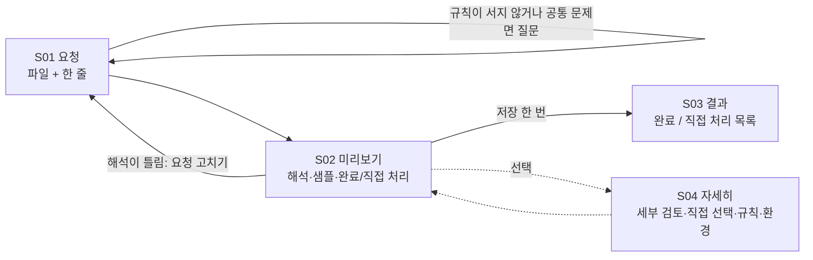

# 우렁각시 요구사항 (PRD)

> 버전: 1.4 · 작성일: 2026-11-09 · 상태: 기능 기준안, 구현·성능 검증 전
> 확정된 추가 요구: 로컬 AI 자연어 규칙 후보 생성을 첫 버전에 포함한다. (2026-11-02 사용자 답변)
> v1.2 사용자 요구: 사용자는 복잡한 설정이나 여러 선택지 없이 자연어로 간단히 작업을 요청한다. 시스템은 명확하게 수행할 수 있는 부분을 자동 처리하고, 결과에서 완료한 영역과 사람이 직접 처리해야 할 영역을 구분해 보여준다. (2026-11-09 사용자 확정. 직접 처리 목록은 결과 XLSX 밖에 둔다)
> v1.3 사용자 확정: 애매한 칸은 질문하지 않고 비워 두며, 왜 채우지 않았는지 종류별로 별도 파일에 소명한다. 같은 문제를 가진 칸이 전체의 일정 비율을 넘을 때만 그 공통 문제를 질문한다. 빈칸 채우기와 값 검토를 구분하고, 값 자동 갱신은 하지 않는다. 결과 XLSX는 작성한 칸만 달라지는 최소 변경 방식으로 저장한다. (2026-11-09 사용자 확정)
> v1.4 사용자 확정: 문서와 표의 키가 동일하지 않으면 오류 파일로 본다. 결과를 Excel로 연다고 가정하지 않는다. XLSX→HWPX 채우기와 AI 유료 서빙은 하지 않는다. (2026-11-09)

## 1. 제품 정의

우렁각시는 공공업무를 수행하는 개인이 자신의 자잘하고 반복적인 문서 업무를 스스로 처리하도록 돕는 로컬 업무 보조 도구다. 첫 버전은 여러 HWPX 업무 문서에서 필요한 값을 찾아 기존 XLSX 취합표에 옮기는 작업을 지원한다.

사용자는 파일을 넣고 한 줄 자연어로 작업을 요청한다. 시스템은 요청을 재사용 가능한 작업 규칙으로 해석해 전체 문서에 적용하고, **고정된 자동 처리 기준(6.1절)을 모두 만족하는 칸만 자동 처리**한다. 나머지는 **채우지 않고** 왜 채우지 않았는지 종류별로 소명해 **직접 처리할 영역**으로 넘긴다. 요청은 빈칸 채우기 또는 값 검토(표를 바꾸지 않고 원본과 대조)다. 사용자는 해석 한 줄과 샘플을 보고 [저장]을 한 번 누른다. 저장은 원본이 아닌 별도 XLSX 사본에만 한다.

핵심 가치는 **설정 없는 한 줄 요청**, **완료와 직접 처리의 명확한 구분**, **유사 양식에 재사용**, **원문 근거와 저장 결과 확인**, **업무자료의 로컬 처리**다.

### 1.1 문서의 근거와 결정 수준

| 구분 | 적용 내용 |
|---|---|
| 기존 문서에서 계승 | HWPX→XLSX, 구조 기반 선택, 규칙 저장·재사용, 매칭, 미리보기·승인, 사본 저장, 근거·재열기 검증, 오프라인·비학습 정책 |
| 이번에 사용자 확정 | 자연어 보조를 MVP에 포함. 개인이 자신의 자잘한 공공업무를 스스로 해결하는 목적이며, 규칙 설정과 결과 확인을 별도 사용자 역할로 나누지 않음 |
| v1.4 사용자 확정 (2026-11-09) | 키는 글자 그대로 일치만 인정. Excel 외 프로그램도 고려. XLSX→HWPX 채우기는 MVP 제외. AI 유료 서빙 없음. 사용 환경은 대부분 사무용 데스크톱 |
| v1.4 에이전트 권고, 사용자 이견 없음 (2026-11-09) | 문서가 없는 행 보고. UI는 PySide6. 근거 JSON은 원문 포함·마스킹 없음 |
| v1.3 사용자 확정 (2026-11-09) | 애매한 칸은 비워 두고 종류별로 소명. 질문은 공통 문제가 전체의 일정 비율을 넘을 때만. 빈칸 채우기·값 검토 구분. 자동 갱신 없음. 작성한 칸만 달라지는 최소 변경 저장 |
| v1.2 사용자 확정 (2026-11-09) | 한 줄 요청 → 완료/직접 처리 구분 미리보기 → [저장] 한 번. 자동 처리 기준은 AI 신뢰도가 아닌 고정 규칙. 저장 전 해석 한 줄과 샘플 2~3건 표시. 직접 처리 목록은 결과 XLSX에 넣지 않고 앱 화면과 별도 텍스트 파일로 제공 |
| 이번 PRD의 제안 기본값 | 기존 행 갱신, 수식·병합 영역 쓰기 차단, 자동 덮어쓰기 금지, 부분 처리 표시, 검토·승인 무효화 정책 등 상세 동작 |
| 아직 미결 | 모델·하드웨어, 지원 문서 세부 구조, 입력 한도, 배포 패키지, 근거 보존 기간·성능 수치의 최종 확정 |

제안 기본값은 개발·화면 검토를 위한 기준이며 사용자가 개별 승인한 정책으로 표현하지 않는다. 이전 문서의 ‘MVP에서 AI 제외’ 문구와 충돌하는 경우 이번 사용자 답변을 적용한다. 기존 문서는 서비스명 표기만 ‘우렁각시’로 맞췄으며, 기능 범위는 별도로 수정하지 않았다.

## 2. 사용자와 해결할 문제

| 사용자 | 업무 상황 | 필요한 결과 |
|---|---|---|
| 공공업무를 수행하는 개인 | 본인이 맡은 자료 취합·값 옮기기·대조 등 작고 반복적인 문서 작업 | 다른 담당자나 개발자의 도움 없이 작업을 끝내고 필요한 부분만 직접 확인 |

규칙 설정·실행·결과 확인은 같은 사람이 자기 업무를 처리하는 과정에서 하는 행동이다. 사용자를 규칙 작성자와 검토 담당자로 분리하거나 담당자 사이의 인계·검수를 전제하지 않는다. 여기서 ‘규칙’은 사용자가 지정한 작업 방법을 뜻하며 전문 지식을 가진 별도 작성자가 필요한 산출물이 아니다.

| 같은 사용자가 겪는 상황 | 우렁각시가 도울 일 |
|---|---|
| 여러 문서의 값을 취합표로 옮겨야 함 | 필요한 항목을 말하거나 선택해 반복 입력을 줄임 |
| 자동으로 옮긴 값이 맞는지 확인하고 싶음 | 바뀔 값과 원문 위치를 보여주고 애매한 항목을 확인하게 함 |
| 다음에 비슷한 일을 다시 해야 함 | 저장한 작업 방법을 새 문서에 재사용 |

별도 계정, 조직 관리, 역할별 접근 제어, 실시간 공동 편집은 제공 범위에 넣지 않는다. 로컬 파일 접근 권한은 운영체제 권한과 사용자가 선택한 파일 범위로 제한한다.

### 2.1 대표 시나리오

1. 사용자가 사업계획 HWPX 여러 개와 `사업취합.xlsx`를 끌어다 놓는다.
2. “사업코드가 같은 행의 예산 열에 사업비를 원 단위로 넣어줘”라고 한 줄 입력한다. 지난번과 같은 일이면 최근 작업을 눌러 요청을 대신한다.
3. 넣을 열을 정할 수 없으면 짧게 묻는다(예: “‘예산 열’이 2026 예산(D열)인가요, 2025 예산(C열)인가요?”). 단위가 없는 금액처럼 같은 문제가 전체 칸의 일정 비율을 넘으면 그 공통 문제도 묻는다(6.2절). 그보다 적은 애매함은 묻지 않고 비워 둔다.
4. 미리보기에 해석 한 줄과 샘플 2~3건이 나온다. 그 아래에 **완료 영역**(자동으로 쓸 칸 38개, 이미 같은 값 4개)과 **직접 처리 영역**(칸 주소·이유·할 일 5건, 읽지 못한 파일 1개)이 나뉘어 보인다.
5. 사용자는 해석과 샘플이 맞는지만 보고 [저장]을 누른다. 해석이 틀리면 요청을 고쳐 다시 보낸다.
6. 별도 결과 XLSX를 만들고 원본과 비교해 작성한 칸만 달라졌는지 확인한다. 채우지 않은 칸은 비어 있거나 기존 값 그대로다. 왜 채우지 않았는지는 화면과 `<결과명>_확인필요.txt`에 종류별로 나온다. 사용자는 그 목록의 칸부터 직접 작업한다.
7. 이번 요청은 작업 규칙으로 자동 저장되어 다음에 다시 쓸 수 있다. 결과 셀마다 원문 근거를 확인할 수 있다.

같은 화면에서 “D열이 문서와 맞는지 봐줘”라고 요청하면 값 검토가 된다. 표는 바꾸지 않고 일치·불일치·표에 빠진 값을 대조표로 받는다.

세부 검토(대상 행 직접 선택, 값 보정, 기존값 덮어쓰기 선택)와 직접 선택 방식의 규칙 작성은 ‘자세히’ 화면에 있다. 기본 흐름에서는 쓰지 않아도 된다.

모든 예시 문서명·사업명·금액은 합성 사례다.

## 3. 목표와 출시 범위

### 3.1 첫 버전 목표

- 비개발자가 설정 없이 한 줄 자연어로 작업을 요청할 수 있다. 직접 선택 방식도 같은 형식의 규칙을 만든다.
- 한 규칙을 여러 유사 양식 HWPX에 재사용할 수 있다.
- 정확히 판단할 수 없는 값은 자동 처리하지 않고 직접 처리 영역으로 분리한다. 사용자는 무엇이 끝났고 어디부터 직접 하면 되는지 결과 화면에서 바로 안다.
- 승인한 변경만 사본에 반영하고, 근거와 실제 저장값을 대조한다.
- 같은 분석으로 값 검토를 할 수 있다. 값 검토는 파일을 고치지 않는다.
- 미리 설치한 의존성과 로컬 모델로 인터넷 없이 두 입력 방식을 모두 실행한다.

### 3.2 우선순위

| 구분 | 기능 | 복잡도 | 출시 판단 |
|---|---|---|---|
| P0 | 입력 검증·구조 미리보기·원본/대상 선택 | 보통 | 필수 |
| P0 | 규칙 생성·검증·저장·재사용 | 높음 | 필수 |
| P0 | 로컬 자연어 후보 생성·사용자 확인·직접 선택 대체 경로 | 높음 | 필수. 개발 순서는 엔진 이후여도 MVP 범위에 포함 |
| P0 | 값 추출·정규화·정확 일치 매칭·충돌 검토 | 높음 | 필수 |
| P0 | 변경 미리보기·승인·사본 저장·재열기 검증·근거 보고서 | 높음 | 필수 |
| P0 | 로컬 실행·외부 전송/학습 금지·접근 제한 | 높음 | 전 기능에 적용 |
| P1 | 유사도 기반 후보 정렬·규칙 목록 검색·편의 기능 | 보통 | P0 이후 개선. 유사도 자동 확정은 포함하지 않음 |
| 후속 | XLSX→XLSX, 바이너리 HWP 입력, HWPX 결과 작성 | 높음 | 첫 버전 제외 |

### 3.3 첫 버전에서 만들지 않는 것

- PDF·스캔·OCR·웹 업무 자동화, 화면 녹화·화면 좌표 기반 RPA.
- 모든 HWP/HWPX 양식 지원, 한글 문서 화면의 완전한 재현.
- HWPX 원본 수정, 대상 XLSX의 행·열 삽입/삭제와 새 사업 행 자동 추가.
- 외부 AI API, 원격 모델, 사용자 자료를 이용한 학습·파인튜닝.
- 자연어에서 임의 프로그램·수식·셸 명령을 생성해 실행하는 기능.
- 다중 사용자 서버, 조직 계정·결재, 클라우드 공유·동기화.
- Excel 수식 재계산(열 때 Excel이 다시 계산하도록 표시만 한다).
- 다른 값이 있는 칸의 자동 갱신.

기존 XLSX의 검증된 일반 셀을 갱신하는 방식으로 범위를 제한한다. 범위 밖 요소를 가진 문서는 호환성 검사에서 설명하고 지원 여부를 판정한다.

## 4. 화면 구성과 사용자 흐름

아래 흐름은 한 사용자가 자신의 작업을 시작해 결과를 얻는 과정이다. 기본 흐름은 화면 3개이고, 세부 기능은 ‘자세히’ 화면에 모았다. ‘저장’ 버튼은 본인이 해석·샘플·완료 영역을 보고 파일에 반영하기로 결정하는 **승인 행동**이다. 별도 검토자 배정이나 조직 결재를 뜻하지 않는다.

| 화면 | 보여줄 정보 | 사용자 행동 | 다음 단계 조건 |
|---|---|---|---|
| S01 요청 | 파일 놓는 곳(HWPX 여러 개·XLSX 하나), 한 줄 요청칸, 최근 작업(저장된 규칙), AI 준비 상태 한 줄. 필요하면 질문(6.2절)과 버튼 2~3개·직접 입력 | 파일 놓기·빼기, 한 줄 요청 또는 최근 작업 누르기, 질문에 답하거나 건너뛰기 | 사용 가능한 원본 1개 이상, 대상 1개, 해석 가능한 요청 |
| S02 미리보기 | 작업 종류(채우기·검토)가 앞에 붙은 해석 한 줄, 샘플 2~3건(원본값 → 대상 칸 = 값), 해석 경보(FR-07), **완료 영역**(쓸 칸·이미 같은 값 건수와 목록), **직접 처리 영역**(종류별 건수와 칸 주소·이유·할 일, 읽지 못한 파일), 결과 파일 이름 | [결과 저장] 또는 값 검토의 [대조표 저장], 요청 고치기, 자세히 | 채우기는 쓸 칸 1개 이상, 입력 스냅샷 최신 |
| S03 결과 | 결과 파일, 검증 요약, **채운 칸 N / 안 채운 칸 M(종류별 건수)** 목록, 확인필요 파일 위치, 셀별 근거 | 결과 파일 열기, 확인필요 파일 열기, 근거 조회, 새 요청 | 성공·실패 모두 사유 제공 |
| S04 자세히 | 구조 미리보기(원본 문단·표, XLSX 시트·헤더·행), 항목별 상세(후보·근거·기존값), 직접 선택 규칙 편집, 규칙 목록·버전, 로컬 모델 상태·진단, 출력 위치 | 대상 행 선택, 값 보정, 기존값 덮어쓰기 선택, 제외, 직접 선택으로 규칙 작성, 규칙 삭제, 출력 위치 변경 | 바뀐 내용은 S02 미리보기와 완료/직접 처리 구분에 즉시 반영. 삭제는 명시적 확인 |

진행 상태(분석·AI·저장·검증)는 별도 화면 없이 S02·S03 안에 표시하고, 취소 버튼과 중복 실행 방지를 둔다. 결과 파일 이름은 기본으로 대상 XLSX와 같은 폴더의 `<대상명>_우렁각시_<날짜시각>.xlsx`이고 S04에서 바꿀 수 있다. 파일·요청·세부 검토가 바뀌면 영향을 받는 미리보기와 승인을 무효화한다. 모든 상태는 색상 외에 텍스트로도 표시한다(완료/직접 처리는 글자와 기호로 구분). 주요 동작은 키보드로 접근할 수 있어야 한다.

## 5. 기능 요구사항과 수용 조건

아래 `FR-*`는 이 PRD의 기능 ID다. 기존 기술 설계서의 같은 형식 ID와 별개다. 모든 수용 조건은 구현 후 확인할 기준이다.

### FR-01. 작업 생성과 파일 선택 — P0

**동작:** HWPX 여러 개, 대상 XLSX 하나, 출력 폴더를 선택해 작업을 만든다. 파일별 이름·형식·읽기 상태를 표시한다. 같은 내용의 파일을 중복 선택한 경우 알리고 기본적으로 한 번만 처리한다.

**수용 조건:** 지원 HWPX 3개와 XLSX 1개를 선택하면 원본 3개·대상 1개가 표시된다. 원본 추가·제거 시 분석 결과가 초기화된다. 대상/출력 경로에 원본과 동일한 경로를 지정하면 쓰기를 차단한다.

### FR-02. 지원 여부와 읽기 검증 — P0

**동작:** 확장자와 실제 파일 형식, 읽기 권한, 손상 여부, 지원 구조와 입력 한도를 검사한다. 암호화 문서·비지원 형식은 처리하지 않는다. 실패한 원본은 이유를 표시해 제외할 수 있고, 대상 읽기 실패는 작업 전체를 막는다.

**수용 조건:** 정상 원본 2개와 손상 파일 1개를 넣으면 실패 파일이 특정된다. 사용자가 이를 제외한 후 나머지로 진행할 수 있다. 실패를 빈 값이나 성공 항목으로 바꾸지 않는다. 입력 한도 초과는 분석 시작 전에 설명한다.

### FR-03. 구조화된 문서 미리보기 — P0

**동작:** HWPX의 문단·표·행·셀과 원본 위치를 표시한다. XLSX의 시트·헤더·데이터 범위·셀 주소·기존값을 표시한다. 문서의 시각적 페이지 전체를 복제하지 않는다.

**수용 조건:** 샘플의 사업비 셀을 선택하면 값과 표/행/열 위치가 함께 표시된다. XLSX 시트와 헤더 행을 바꾸면 실제 열·데이터 범위가 갱신된다. 인접한 표의 같은 라벨은 서로 구분된다.

### FR-04. 직접 선택으로 규칙 구성 — P0

**동작:** ‘자세히’ 화면에서 원본 추출 항목, 원본 레코드 범위, 대상 시트·헤더·열·행 범위, 원본/대상 연결 키, 자료형·단위를 지정한다. 기존값 처리는 선택지가 아니라 고정 정책(6.1절)이다. 한 원본의 복수 사업 행은 각각 별도 레코드로 취급한다. AI가 준비되지 않았거나 요청 해석이 계속 틀릴 때의 대체 경로다.

**수용 조건:** 사용자가 코드 없이 ‘사업코드로 행 연결, 사업비를 예산 열에 입력’ 규칙을 구성한다. 필수 항목이 빠지면 누락 위치를 알리고 전체 적용을 차단한다. 단순 셀 좌표만이 아니라 라벨·주변 구조를 규칙에 반영한다.

### FR-05. 자연어 규칙 후보 생성 — P0

**동작:** 한 줄 요청과 입력 문서의 구조(원본 표·라벨 일부, 대상 시트·헤더)를 로컬 AI에 전달한다. 모델은 작업 종류와, 주어진 목록 안에서 값 위치·키 위치·대상 열만 고른다. FR-04와 동일한 구조의 규칙은 **코드가 만들고**, 만든 규칙으로 다시 추출해 고른 위치에 도달하는지 자기 대조한다. 항목명은 여러 문서에서 같은 위치에 반복되는 글자만 인정한다. 검증을 통과하지 못하면 해석으로 쓰지 않는다. 사용자가 범위를 미리 고르지 않아도 된다. 질문은 6.2절 기준에 해당할 때만 한다.

**수용 조건:** ‘사업코드가 같은 행의 예산 열에 사업비를 원 단위로 넣어줘’ 입력 시 미리보기가 나오며 XLSX는 바뀌지 않는다. ‘예산 정리해줘’처럼 넣을 열을 정할 수 없는 입력에는 질문이 나오고 미리보기는 나오지 않는다. 존재하지 않는 열, 금지 연산, 잘못된 형식의 응답은 규칙으로 채택하지 않는다. AI 문장을 해석 표시에 그대로 쓰지 않고, 검증된 규칙에서 해석 한 줄을 만든다(FR-07).

### FR-06. AI 준비 상태와 실패 대응 — P0

**동작:** 로컬 실행기·설치된 모델·연결 허용 범위·추론 준비 상태를 표시한다. 모델은 사전에 준비한 로컬 모델만 사용한다. 업무 처리 중 자동 다운로드·클라우드 대체를 하지 않는다. 설치 안내와 실제 문서 처리를 구분한다.

**수용 조건:** 모델 미설치, 실행기 중지, 시간 초과, 메모리 부족이면 이유와 재시도·직접 선택 버튼을 제공한다. 실패 후 기존 수동 규칙이 보존된다. 외부 서버 주소·클라우드 모델은 선택할 수 없다. 정해진 AI 시험 환경에서 인터넷 차단 상태의 실제 후보 생성이 성공해야 MVP 출시 기준을 통과한다.

### FR-07. 해석 한 줄과 샘플 확인 — P0

**동작:** 미리보기 맨 위에 해석 한 줄과 샘플 2~3건을 보여준다. 해석 한 줄은 검증된 규칙에서 정해진 문장 틀로 만든다(어느 키로 행을 찾고, 무엇을, 어느 열에, 어떤 단위로). 샘플은 완료 영역에서 서로 다른 원본 파일과 서로 다른 표기(단위 등)를 우선해 골라 ‘원본 파일·원문값 → 대상 칸 = 넣을 값’으로 보여준다. 답할 수 없는 같은 문제가 전체의 일정 비율을 넘으면 해석 경보를 띄운다(예: “37건 중 35건이 대상 없음 → 연결 기준이 틀렸을 수 있음”). 별도 규칙 확인 단계는 두지 않는다. 해석이 틀렸다면 요청을 고쳐 다시 보낸다.

**수용 조건:** 미리보기를 보는 동안 대상 파일은 바뀌지 않는다. 대상 열을 잘못 잡은 규칙(예: 2025 예산 열)은 해석 한 줄의 열 이름·주소와 샘플 칸 주소로 드러난다. 완료 영역이 비어 있으면 샘플 대신 그 이유를 보여준다. 대상 없음이 대부분인 묶음에서는 해석 경보가 나온다.

### FR-08. 규칙 저장·수정·재사용 — P0

**동작:** [저장]을 누르면 그 요청의 규칙과 질문 답을 로컬에 자동 저장한다. 이름은 요청 문장에서 만들고 ‘자세히’에서 바꿀 수 있다. 같은 규칙(규칙 지문 동일)은 새로 저장하지 않는다. 다시 실행할 때 이미 답한 질문은 묻지 않는다. 저장된 규칙은 S01의 ‘최근 작업’으로 다시 쓰며 이때는 AI를 부르지 않는다. 기존 규칙을 수정하면 새 버전을 만들고 이전 실행과의 연결은 유지한다. 규칙은 문서 경로·원문값을 기본 포함하지 않으며 실행 시 새 파일과 연결한다.

**수용 조건:** 앱을 다시 열고 최근 작업을 눌러 새로운 유사 양식 원본에 같은 처리를 할 수 있다. AI가 준비되지 않아도 이 경로는 동작한다. 대상 시트·필드가 달라지면 질문 또는 직접 처리 영역으로 표시한다. 규칙 삭제는 확인 후 수행하고 이미 저장된 결과 파일을 삭제하지 않는다.

### FR-09. 필드·레코드 탐색 — P0

**동작:** 표 제목, 헤더, 라벨, 주변 구조와 사용자가 정한 범위로 값을 찾는다. 복수 표·복수 사업을 구분한다. 하나의 필드 후보가 여러 곳이면 임의로 첫 값을 선택하지 않는다. 고정폭·줄바꿈 금지 공백은 공백으로 읽는다. 변경 추적(삭제·삽입 표시)이 남은 칸은 추측하지 않고 ‘값을 확실히 못 읽음’으로 비워 둔다.

**수용 조건:** 지원 양식에서 표 위치만 달라진 새 문서에도 규칙을 적용한다. 같은 이름의 항목이 두 표에 있어 구분되지 않으면 원본 위치를 제시하며 검토 대상으로 남긴다. 한 문서의 사업 2개가 하나의 레코드로 섞이지 않는다.

### FR-10. 자료형·단위 정규화 — P0

**동작:** 문자열·숫자·금액·날짜를 규칙에 따라 변환하고 원본값을 보존한다. 금액은 원·천원·만원·백만원을 명시적으로 변환한다. 단위가 없으면 규칙의 기본 단위가 지정된 경우에만 사용한다. 사업코드는 문자열로 다뤄 앞자리 0을 보존한다.

**수용 조건:** `350만원`은 대상 단위가 원일 때 `3,500,000`으로 미리보기된다. `0`, 빈 값, `미정`은 구분된다. 단위 모호·날짜 해석 모호·숫자 변환 실패는 검토로 분류한다. 반올림이 필요하면 규칙에 방법을 지정하기 전 자동 작성하지 않는다.

### FR-11. 대상 행 매칭 — P0

**동작:** 사업코드 등 키는 글자 그대로 일치할 때만 연결한다. 문서와 표의 키가 다르면 공백 차이여도 오류 파일로 보고 ‘들어갈 행을 못 정함’으로 소명한다. 유사도는 후보 제시에만 사용한다. 대상에 없는 키는 자동으로 행을 만들지 않는다.

**수용 조건:** 정확히 일치하는 대상 행이 하나면 연결한다. 같은 키가 복수 행에 있거나 후보만 유사하면 검토로 보낸다. 유사도가 높아도 자동 확정하지 않는다. 대상에 없는 키는 ‘대상 없음’으로 표시한다.

### FR-12. 누락·중복·충돌 검토 — P0

**동작:** 누락·중복·충돌 항목은 기본 흐름에서 직접 처리 영역으로 간다(이유·할 일 표시). 앱 안에서 해결하고 싶으면 ‘자세히’에서 원본/대상 후보 선택, 값·단위 보정, 제외를 할 수 있다. 보정값은 자동 추출값과 구분하고 사유를 기록한다. 해결된 항목은 완료 영역으로 옮겨진다.

**수용 조건:** 서로 다른 원본이 같은 대상 셀에 다른 값을 쓰려 하면 충돌로 묶이고 마지막 값으로 덮어쓰지 않는다. 동일한 값이라도 중복 근거를 표시하고 한 번의 쓰기로 묶는다. 미해결 항목은 쓰지 않고 직접 처리 목록에 남는다. 해결·제외 내역은 최종 요약과 근거에 남는다.

### FR-13. 변경 전후 미리보기 — P0

**동작:** 미리보기는 완료 영역과 직접 처리 영역으로 나뉜다. 각 항목에서 원본 파일·레코드, 대상 시트·주소, 기존값, 변환 후 값·단위, 근거를 볼 수 있다(상세는 ‘자세히’). 모든 대상 셀 쓰기는 완료 영역에 표시된 목록에서만 발생한다.

**수용 조건:** 같은 값이면 ‘이미 같은 값’으로 완료 영역에 넣고 쓰지 않는다. 대상 칸에 다른 값이 있으면 자동으로 덮어쓰지 않고 직접 처리 영역에 기존값·제안값과 함께 둔다. 사용자가 ‘자세히’에서 해당 칸의 덮어쓰기를 직접 선택한 경우에만 완료 영역으로 옮긴다. 쓸 칸·이미 같은 값·직접 처리·제외 건수와 파일별 범위가 확인된다.

### FR-14. 최종 승인과 입력 변경 감지 — P0

**동작:** [저장] 한 번이 최종 승인이다. 이 순간 미리보기에 보인 해석(규칙), 완료 영역의 쓰기 목록, 입력 파일 지문, 검토 결정, 출력 경로를 하나의 승인 대상으로 묶는다. 하나라도 달라지면 기존 승인을 사용할 수 없다. AI 후보 생성은 승인이 아니다. 해석·샘플·완료 영역이 보이기 전에는 [저장]을 누를 수 없다. 화면 없는 실행(CLI)은 두 단계로 한다. `prepare`가 미리보기와 계획 지문을 파일로 내고, 사람이 그 내용을 본 뒤 `commit`에 같은 지문을 넘길 때만 저장한다. 지문이 다르면 저장하지 않는다.

**수용 조건:** 미리보기 후 XLSX가 외부에서 변경되면 저장을 막고 다시 미리보기를 만든다. 요청 수정·파일 추가·세부 검토·출력 경로 변경 후에는 새 미리보기가 나오고 다시 [저장]해야 한다.

### FR-15. 보호 셀과 사본 작성 — P0

**동작:** 원본과 다른 신규 파일명으로 XLSX 사본을 생성한다. 수식 셀, 병합 영역, 보호된 셀은 MVP 쓰기 대상에서 차단한다. 기존 결과 파일도 자동 덮어쓰지 않는다. **최소 변경 저장:** 대상 시트 XML에서 작성할 칸만 고치고 나머지 패키지 항목은 내용 그대로 복사한다. 작성한 칸의 서식은 유지한다. 통합문서에 수식이 있으면 열 때 다시 계산하도록 표시한다. Excel로 연다고 가정하지 않으며 Excel과 한셀로 시험한다. 다시 계산하지 않는 프로그램에서는 수식 칸이 옛값으로 보일 수 있으므로, 통합문서에 수식이 있으면 결과 화면에 안내한다.

**수용 조건:** 입력 HWPX·XLSX 지문이 작업 전후 동일하다. 수식 셀에 대한 쓰기는 검토 화면에서 차단되고 우회 승인할 수 없다. 잠금·쓰기 권한 부족·디스크 부족이면 저장 실패와 재시도 방법을 표시한다. 입력이 문자열이면 수식으로 실행되지 않게 저장한다.

### FR-16. 결과 재열기 검증 — P0

**동작:** 작성한 파일을 다시 열어 승인된 변경의 주소·자료형·단위 기준 예상값과 실제값을 대조한다. 원본과 사본을 비교해 패키지 항목 목록이 같고, 달라진 곳이 작성한 칸과 재계산 표시뿐인지 검사한다. 파일 검증을 통과하기 전 정상 결과로 제공하지 않는다.

**수용 조건:** 승인 변경 10개 중 1개라도 저장값이 다르거나 파일이 열리지 않으면 해당 실행을 검증 실패로 표시한다. 불완전 파일은 정상 다운로드/열기 대상으로 노출하지 않는다. ‘확인됨’은 정해진 출처·변환·저장 검사를 통과했다는 뜻으로 표시하며 행정적 내용의 진실성을 보증하지 않는다.

### FR-17. 셀별 근거와 결과 보고서 — P0

**동작:** 대상 셀에서 원본 파일 식별자·지문, 문단/표/행/열 위치, 원본값, 변환, 매칭·수동 보정 내역, 규칙 버전, 검증 결과를 확인한다. 결과와 연결되는 로컬 JSON 근거 보고서 및 읽을 수 있는 요약을 제공한다.

**수용 조건:** 결과의 `사업취합!D5`를 선택하면 대응 원본 위치와 변환 경로가 나타난다. 수동 보정값은 사유와 자동 추출값이 구분된다. 원본이 이동/삭제되면 보고서의 보관 근거는 표시하되 원문 열기 불가를 알린다. 원본이 변경되면 지문 불일치로 경고한다.

### FR-18. 실행 진행·취소·재시도 — P0

**동작:** 분석·AI 후보 생성·작성·검증 단계를 표시하고 중복 실행을 막는다. 분석/추론은 취소 요청을 받고, 작성/검증 중 취소는 안전한 경계에서 처리한다. 중단된 작업은 자동 재개하지 않는다.

**수용 조건:** 취소하면 원본과 기존 결과가 보존된다. 임시 출력은 정리하며 정리 불가 시 경로와 이유를 알린다. 재시도는 입력 지문·승인 유효성을 재확인한다. 입력이나 경로가 바뀌면 재분석·재승인한다. 앱 종료 시 미저장 규칙이 있으면 알린다.

### FR-19. 로컬 처리·파일 접근·보존 — P0

**동작:** 업무 문서, 프롬프트, 파생값, 근거를 외부로 전송하거나 학습에 사용하지 않는다. 승인한 입력·출력 범위만 사용한다. 일반 진단 로그에는 원문·프롬프트·추출값을 남기지 않는다. 민감한 원문값이 포함되는 근거 보고서는 사용자에게 저장 위치와 포함 범위를 안내한다.

**수용 조건:** 네트워크 차단 상태에서 직접 선택 및 실제 로컬 AI 흐름이 완료된다. 앱과 관리 대상 하위 프로세스에서 외부 연결 시도 0건을 시험으로 확인한다. 허용 범위 밖 경로를 가진 규칙과 임의 명령은 거부한다. 앱 임시파일은 성공·실패·취소 후 정리한다. 모델 서버 로그·캐시도 시험 범위에 넣는다.

### FR-20. 결과 상태와 부분 처리 표시 — P0

**동작:** 항목 상태는 ‘확인됨·검토 필요·실패·사용자 제외·변경 없음’으로 구분한다. 실행 상태와 항목 상태를 구분하고, 제외/실패 원본이 있으면 완료 화면에서 명시한다.

**수용 조건:** 원본 10개 중 2개를 제외하고 저장한 경우 ‘부분 완료’와 제외 원본 2개를 표시한다. 검증 실패를 부분 완료로 낮추지 않는다. 쓸 칸이 0개면 결과 사본을 새로 만들지 않고 직접 처리 목록만 제공한다. 근거 보고서나 확인필요 파일 저장 실패도 정상 완료로 표시하지 않는다.

### FR-21. 자동 처리 판정과 안 채운 칸의 종류별 소명 — P0

**동작:** 모든 항목을 **완료 영역**(쓸 칸, 이미 같은 값), **직접 처리 영역**(안 채운 칸), **제외**(사용자가 ‘자세히’에서 뺀 것) 중 하나로 나눈다. 자동 처리는 6.1절의 고정 기준을 모두 만족한 칸에만 한다. AI 신뢰도 점수는 판정에 쓰지 않는다. 애매한 칸은 채우지 않고, 6.3절의 종류별로 왜 채우지 않았는지와 할 일을 소명한다. 각 항목에는 칸 주소(없으면 원본 파일·위치)를 붙인다. 읽지 못한 원본 파일과, 대상 범위에서 어떤 문서와도 연결되지 않은 행(문서가 없는 행)도 포함한다. 결과 XLSX에는 시트·색칠·메모를 추가하지 않는다. 소명은 S03 화면과 결과 옆 `<결과명>_확인필요.txt`(UTF-8)로 제공한다. 이 파일에는 문서의 실제 값이 들어가므로 제출·전달용이 아니라는 안내를 첫머리와 화면에 넣는다.

**수용 조건:** 정상·기존값 다름·대상 없음·복수 행·충돌·수식 칸·단위 모호·읽기 실패가 섞인 묶음에서 완료 영역에는 6.1절 기준을 만족한 칸만 있다. 확인필요 파일과 화면 목록은 직접 처리 항목과 1:1로 같고, 종류별로 묶이며 각 항목에 주소가 있다. 결과 XLSX의 시트 수·시트 이름은 입력 대상과 같다. 직접 처리 항목이 0건이면 확인필요 파일을 만들지 않고 ‘직접 처리할 것 없음’을 표시한다.

### FR-22. 값 검토 — P0

**동작:** 요청이 값 확인이면 표를 바꾸지 않고 원본 값과 대조한다. 작업 종류는 요청 문장에서 정하고 해석 한 줄 맨 앞에 표시한다. 정할 수 없으면 묻는다. 결과는 일치 건수와 불일치·표에 빠짐·문서가 없는 행 목록(원본값·표값·근거)이다. 표와 문서 중 어느 쪽이 맞는지는 판단하지 않는다. 불일치를 표에 자동 반영하지 않는다. 고치는 일은 사용자가 Excel에서 직접 한다.

**수용 조건:** 일치·불일치·표에 빠짐·판정 불가가 섞인 묶음에서 각 건수와 목록이 정답과 같다. 결과 XLSX를 만들지 않고 대조표(확인필요 파일)와 근거 JSON만 만든다. 대상 XLSX와 원본의 지문은 작업 전후 같다.

## 6. 공통 업무 정책

| 상황 | 기본 처리 | 사용자가 할 수 있는 일 |
|---|---|---|
| 원본 필수값 없음 | 직접 처리, 빈 값으로 덮어쓰지 않음 | 원문 확인 후 직접 입력, 또는 ‘자세히’에서 보정·제외 |
| 대상 셀에 다른 값 있음 | 직접 처리, 자동 덮어쓰기 없음. 기존값·제안값 표시 | 직접 입력, 또는 ‘자세히’에서 일반 셀에 한해 덮어쓰기 선택 후 저장 |
| 같은 사업 키가 여러 대상 행에 존재 | 직접 처리, 자동 매칭 중지 | 맞는 행에 직접 입력, 또는 ‘자세히’에서 대상 행 선택 |
| 키가 대상에 없음 | 직접 처리, 행 자동 추가 없음, 파일 오류 의심으로 안내 | 파일의 키를 확인하거나 행 추가를 직접 판단 |
| 표의 행에 연결된 문서가 없음 | 직접 처리, 문서가 없는 행으로 보고 | 빠진 문서를 확인 |
| 같은 대상 셀에 서로 다른 값 | 직접 처리, 자동 확정 금지 | 원본 확인 후 직접 입력, 또는 ‘자세히’에서 근거 선택·보정 |
| 비지원 수식·병합·보호 셀 쓰기 | 직접 처리, 쓰기 차단(우회 불가) | 셀 구조를 확인해 직접 입력 |
| 원본 또는 대상이 승인 후 바뀜 | 승인 무효 | 다시 미리보기 후 저장 |
| 부분 처리 | 완료 영역만 쓰고 직접 처리 목록 제공 | 목록의 칸부터 직접 작업 |
| 결과 파일명이 이미 존재 | 쓰기 차단 | 다시 미리보기(새 시각 이름) 또는 ‘자세히’에서 이름 변경 |
| 문서 안에 지시·명령 문자열 존재 | 문서 데이터로만 취급 | 값 확인. 실행 지시로 채택하지 않음 |

표의 건수는 파일 수·레코드 수·대상 셀 변경 수를 구분해 표시한다. 하나의 파일에 여러 사업, 하나의 사업에 여러 쓰기가 있을 수 있어 단순 합산하지 않는다.

### 6.1 자동 처리 기준 (v1.2 확정)

한 칸은 아래를 **모두** 만족할 때만 완료 영역에 들어간다. 하나라도 어긋나면 직접 처리 영역이다. 기준은 고정 규칙이며 AI 신뢰도 점수를 쓰지 않는다. 사용자가 고르는 설정이 아니다.

1. 해석된 규칙이 검증을 통과했다(존재하는 시트·열, 허용 연산, 올바른 형식).
2. 원본에서 값이 한 곳에서만 찾아졌다(같은 라벨 복수 위치 없음).
3. 자료형·단위 변환이 모호하지 않다(단위 명시 또는 규칙의 기본 단위, 반올림 불필요).
4. 대상 행이 키의 정확 일치로 정확히 하나다.
5. 대상 칸이 수식·병합·보호 칸이 아니다.
6. 대상 칸 상태가 작업 종류의 완료 조건에 맞는다. 빈칸 채우기는 비어 있거나(→ 쓸 칸) 이미 같은 값(→ 쓰지 않음)이고, 값 검토는 같은 값(→ 일치)이다.
7. 같은 칸에 다른 값을 쓰려는 원본이 없다.

이 기준은 각 칸을 개별로 판정하므로 **해석 자체가 틀린 경우**(예: 다른 연도 열을 고름)는 잡지 못한다. 이 위험은 저장 전 해석 한 줄·샘플·해석 경보(FR-07)로 사용자가 확인한다.

값 검토에서 다른 값은 ‘불일치’, 빈칸은 ‘표에 빠짐’으로 직접 처리 영역에 간다. 어떤 작업 종류에서도 다른 값을 자동으로 덮어쓰지 않는다.

### 6.2 질문 기준 (v1.3 확정)

칸마다 묻지 않는다. 다음 두 경우에만 묻고, 나머지 애매함은 묻지 않고 비워 둔다.

| 경우 | 대상 | 예 |
|---|---|---|
| 규칙이 서지 않음 | 행 찾는 기준, 넣을 열, 작업 종류를 정할 수 없음 | “‘예산’은 D열(2026 예산)인가요?” |
| 공통 문제 | **같은 문제를 가진 칸이 분석 대상 칸의 30% 이상**이고, 답 하나로 정해지는 문제(기본 단위, 반올림, 날짜 해석) | “단위가 없는 금액 23칸은 천원인가요, 원인가요?” |

- 30%는 코드에 둔 기준값이며 사용자 설정이 아니다. Q01 정답셋으로 조정한다.
- 칸은 한 문제에만 속하므로 공통 문제 질문은 많아야 3개다. 영향이 큰 순서로 한 번에 하나씩 묻는다.
- 답은 그 질문과 같은 경우에만 적용하고, 규칙에 저장해 다시 묻지 않는다. 건너뛰면 해당 칸은 비워 둔다.
- 답으로 안전 기준을 낮출 수 없다. 유사도 자동 확정, 덮어쓰기, 행 추가는 질문 대상이 아니다. 기존값 다름·대상 없음·충돌·막힌 칸은 비율이 높아도 묻지 않고 해석 경보(FR-07)만 띄운다.

### 6.3 안 채운 칸의 소명 종류 (v1.3 확정)

| 종류 | 포함되는 경우 | 왜 채우지 않았나 | 할 일 |
|---|---|---|---|
| 이미 다른 값이 있음 | 빈칸 채우기의 기존값 다름(값 갱신 포함) | 어느 쪽이 맞는지 프로그램이 판단할 수 없음. 기존 값 유지 | 맞는 값을 확인해 직접 고치기 |
| 들어갈 행을 못 정함 | 대상 없음, 복수 행 | 같은 키의 행이 없거나 여러 개임. 키가 문서와 다르면 파일 오류 의심 | 파일의 키를 확인하거나 맞는 행에 직접 입력 |
| 원본끼리 값이 다름 | 충돌 | 같은 칸에 문서마다 다른 값이 있음 | 원본을 확인해 직접 입력 |
| 값을 확실히 못 읽음 | 누락, 같은 항목 여러 곳, 단위 불명, 숫자·날짜 해석 실패, 반올림 필요, 변경 추적 남음 | 값을 하나로 확정할 수 없음 | 원문을 확인해 직접 입력 |
| 쓰면 안 되는 칸 | 수식, 병합, 보호 | 이 칸 구조를 바꿀 위험이 있음 | 칸 구조를 확인해 직접 입력 |
| 파일을 읽지 못함 | 손상, 암호화 등 | 내용을 읽을 수 없음 | 파일을 확인해 다시 넣기 |
| 문서가 없는 행 | 표의 대상 행에 연결된 문서 없음 | 이 행의 값을 가진 문서가 입력에 없음 | 문서가 빠졌는지 확인하기 |
| 값 검토: 불일치·표에 빠짐 | 값 검토 전용 | 표와 문서가 다르거나 표가 비어 있음 | 맞는 값을 확인해 직접 고치기 |
| 직접 처리로 돌린 칸 | ‘자세히’에서 사용자가 뺀 칸 | 사용자가 직접 처리하기로 함 | 직접 입력 |

## 7. 입출력과 지원 계약

| 구분 | 첫 버전 계약 |
|---|---|
| 원본 | 검증된 구조의 HWPX 여러 개. 문단·일반 표·셀, 명시적 사업 레코드 경계 |
| 대상 | 검증된 XLSX 하나. 선택한 시트·헤더·기존 데이터 행 범위 |
| 작성 대상 | 일반 셀 값. 수식·병합 영역·보호된 셀 쓰기 제외 |
| 규칙 | 로컬 저장, 버전 관리, 실행할 파일은 실행 시 연결 |
| 결과 | 빈칸 채우기: 작성한 칸만 달라진 XLSX 사본 1개 + 연결된 JSON 근거 보고서 + 안 채운 칸이 있을 때 `<결과명>_확인필요.txt` + UI 요약. 값 검토: XLSX 없이 JSON 근거 보고서 + 대조표(확인필요 파일) + UI 요약 |
| 보존 | 입력 원본 보존. 결과·근거는 사용자 지정 경로에 저장, 명시적으로 관리 |
| 미지원 | 바이너리 HWP, PDF·이미지, XLS·XLSM, 암호화 파일, 복잡한 비지원 양식 |

파일 수·용량·문서 복잡도 한도와 병합 헤더/중첩 표 등 세부 지원표는 샘플 재현 후 확정한다. 설정된 한도를 초과하거나 검증하지 않은 구조를 만나면 무제한 처리를 시도하지 않고 지원 여부를 설명한다.

## 8. 비기능 요구사항

- **재현성:** 지원 입력과 같은 규칙 버전에 대해 AI 호출 이후의 추출·변환·매칭·저장 결과는 재현 가능해야 한다. AI 후보 문구 자체의 완전한 동일성은 요구하지 않는다.
- **안전한 작성:** 승인 목록 외 셀 수정과 입력 원본 변경 0건. 결과 파일·근거 보고서 쌍이 정상 준비되어야 완료로 제공한다.
- **보존성:** 작성한 칸과 재계산 표시 외의 패키지 내용은 원본과 같아야 한다. 도형·확장 서식·수식 캐시값을 포함한 파일로 시험한다. 수식 재계산 결과는 검증 범위에서 구분한다.
- **응답과 사용성:** 진행 단계, 오류 원인, 복구 행동을 제공한다. 모델 응답 대기 중 취소·직접 선택 전환 경로를 제공한다. 처리시간 목표는 아래 평가 기준안으로 관리한다.
- **데이터 보호:** 로컬 AI 서버와 UI는 로컬 장치 범위로 제한한다. 모델 준비·업데이트와 업무 실행을 분리하고 업무 실행 중 자동 갱신·원격 분석을 사용하지 않는다. 앱과 모델 묶음은 따로 배포하며(지문 고정 내려받기, 내부망·USB 묶음), 인터넷은 설치 때만 필요하다. 모델 묶음이 없으면 AI 기능만 꺼진다.
- **시험 범위:** 앱·관리 대상 하위 프로세스와 모델 실행기를 포함한다. 다른 앱, OS 서비스, 동기화·백업 프로그램 전체의 통제를 보장하는 것으로 표현하지 않는다.

## 9. 성공 지표와 측정 방법

다음 수치는 기존 계획에서 계승하거나 이번 PRD에서 제안한 **목표**이며 실측 결과가 아니다. 합성 데이터의 정답·자동 처리 가능 여부를 먼저 고정하고 개발용/최종 평가용을 분리한다. 시험용 정답 키와 대상 셀은 최종 평가 전에 확정한다.

| 지표 | 목표 기준안 | 분모·측정 방법 |
|---|---|---|
| 필드 추출 정확도 | 95% 이상 | 올바른 원본 위치·값·단위를 추출한 필수 필드 수 / 평가 대상 필수 필드 수. 누락도 오답 |
| 완료 영역 정밀도 | 99% 이상 | 정답 칸·정답 값과 일치한 완료 영역 항목 / 완료 영역 항목. 완료 영역 0건이면 산출 불가·합격 불가. 해석이 맞은 지시만 분모에 넣고 해석 오류는 아래 자연어 지표로 따로 잰다 |
| 자동 처리율 | 80% 이상 | 완료 영역(쓸 칸·이미 같은 값)으로 판정된 칸 / 지원 범위 내 평가 칸. 한 줄 요청·질문 답·[저장]은 수동 작업에서 제외 |
| 직접 처리 목록 정확도 | 100% | 직접 처리 목록의 칸·이유가 정답셋의 ‘사람이 판단해야 하는 칸’과 일치한 비율. 빠진 칸이 있으면 불합격 |
| 규칙 재사용 성공률 | 90% 이상 | 규칙 수정 없이 정답을 얻은 새 평가 문서 / 지원 범위 내 새 평가 문서. 최초 샘플 제외 |
| 실제 저장값 일치 | 정상 완료 변경 100% | 재열기 후 예상값과 일치한 승인 변경 / 승인 변경 |
| 작성 칸 외 변경 | 0건 | 원본·사본 패키지 비교에서 작성한 칸과 재계산 표시 외에 달라진 곳의 수 |
| 값 검토 불일치 검출 | 필수 시나리오 100% | 정답셋의 불일치·표에 빠짐 중 대조표에 나온 수 / 정답 수. 빠진 건이 있으면 불합격 |
| 질문 부담 | 공통 문제 기준 미만이면 0개 | 평가 묶음별 질문 수. 재실행 질문 0개 |
| 오입력 차단 | 필수 위험 시나리오 100% | 중복·단위 불명·수식 대상·승인 후 변경·금지 연산 등의 차단 여부 |
| 자연어 후보의 기능적 정답률 | 90% 이상, 이번 제안 | 명확한 지시 중 추가 수동 수정 없이 정답 규칙 후보 생성 건 / 명확한 평가 지시 수. 문구 동일성이 아닌 필드·키·대상·단위 비교 |
| 불명확·금지 자연어 대응 | 필수 사례 100% | 불명확 지시는 추가 확인, 금지 지시는 차단하고 무승인 파일 수정 0건 |
| 오프라인 종단간 성공 | 지원 필수 시나리오 100% | 의존성·모델 사전 설치 후 인터넷 차단. 직접 선택과 실제 로컬 AI를 각각 시험 |
| 외부 연결·학습 경로 | 관찰 범위 내 위반 0건 | 앱·모델 실행기·관리 하위 프로세스 통신 관찰 및 코드/설정·로그 검사 |
| 수작업 대비 총 시간 | 30% 이상 감소, 이번 제안 | 동일 문서 묶음의 규칙 생성·검토·오류 수정·저장 검증까지 포함. AI 최초 설치 시간은 별도 보고 |

성능 시험 프로파일 초안은 HWPX 20개·합계 100MB 이하, XLSX 1개·1,000 데이터 행, 필드 5개다. 모델 추론을 제외한 일괄 분석·미리보기 60초 이내, 사전 로딩 후 자연어 후보 생성 30초 이내를 목표안으로 두되, 하드웨어·문서 구조·모델 확정 후 재현 시험으로 조정한다. 이는 입력 지원 한도나 이미 달성한 성능을 뜻하지 않는다. AI 준비 시간, 최초 추론 시간, 반복 추론 시간, 검토 시간을 따로 기록한다.

## 10. 출시 수용 시나리오

| ID | 시험 | 기대 결과 | 관련 기능 |
|---|---|---|---|
| AT-01 | 직접 선택으로 3개 문서 사업비 취합 | 승인 변경만 새 XLSX에 저장, 원본 동일, 재검증 일치 | FR-01~04, FR-07~17 |
| AT-02 | 명확한 한 줄 요청으로 동일 작업 | 해석 한 줄·샘플 확인 후 [저장] 한 번으로 AT-01과 동일한 규칙 의미·출력. 규칙 자동 저장 | FR-05~08, FR-14 |
| AT-03 | 모호한 지시·없는 열·명령 실행 지시 | 6.2절 질문 또는 차단, 파일 수정 없음 | FR-05, FR-19 |
| AT-04 | 모델 미설치·중지·시간 초과·자원 부족 | 원인 안내, 직접 선택 정상 진행, 외부 대체 없음 | FR-06, FR-18 |
| AT-05 | 위치가 이동한 표·복수 사업·같은 라벨의 복수 표·실제 한글 저장본·변경 추적·특수 공백 | 지원 구조 탐색, 사업 경계 유지, 모호하면 비움, 변경 추적 칸은 비움, 특수 공백은 공백 | FR-03, FR-09 |
| AT-06 | 단위 혼재·0·빈 값·미정·앞자리 0 코드 | 명시 단위만 변환, 원문 보존, 오류는 검토 | FR-10 |
| AT-07 | 중복 키·유사 이름·대상 없음·동일 셀 충돌 | 임의 매칭·행 추가·덮어쓰기 없음, 해결/제외 기록 | FR-11~12 |
| AT-08 | 기존값 다름·같은 값 | 다른 값은 직접 처리 영역(자동 덮어쓰기 없음, ‘자세히’ 선택 시에만 작성), 같은 값은 완료 영역·미작성 | FR-13~14, FR-21 |
| AT-09 | 수식·병합·보호 셀, 수식처럼 시작하는 문자열 | 보호 쓰기 차단, 문자열의 수식 실행 방지 | FR-15 |
| AT-10 | 미리보기 후 입력/규칙/경로 변경 | 승인 무효, 재분석·재승인 | FR-14 |
| AT-11 | 잠금·디스크 부족·출력명 충돌·검증값 불일치 | 정상 결과 미제공, 원본 보존, 실패 사유와 재시도 | FR-15~16, FR-18 |
| AT-12 | 제외 원본·미해결 항목·쓰기 0건 | 부분 완료 구분, 쓰기 0건은 결과 생성 없음 | FR-12~13, FR-20 |
| AT-13 | 근거 보고서 실패·원본 이동·원본 변경 | 보고서 실패는 완료 불가, 원문 접근·지문 상태 표시 | FR-17, FR-20 |
| AT-14 | 분석/추론/작성 중 취소·중복 실행·강제 종료 후 재실행 | 중복 쓰기 없음, 정상 완료 오인 없음, 새 입력 확인 | FR-18 |
| AT-15 | 앱 재시작 후 규칙 재사용·규칙 수정·삭제 | 버전별 구분, 새 파일 연결, 결과 파일 독립 보존 | FR-08 |
| AT-16 | 인터넷 차단, 실제 로컬 모델 포함 전체 처리 | 로컬 처리 성공, 관리 범위 외부 연결 시도 0건 | FR-06, FR-19 |
| AT-17 | 손상·암호화·비지원·한도 초과·악의적 문서/규칙 | 범위 설명·안전한 거부, 원문 로그·범위 밖 접근 없음 | FR-02, FR-19 |
| AT-18 | 정상·기존값 다름·대상 없음·복수 행·충돌·수식 칸·단위 모호·읽기 실패·문서가 없는 행이 섞인 묶음 | 완료 영역은 6.1절 기준을 만족한 칸만, 확인필요 파일·화면 목록이 직접 처리 항목과 1:1이고 종류별로 묶임, 결과 XLSX 시트 구성 불변 | FR-20~21 |
| AT-19 | 다른 연도 열·틀린 연결 기준으로 해석되는 요청 | 해석 한 줄·샘플에 잘못된 열이 드러나고 대상 없음이 많으면 해석 경보, 요청 수정 후 올바른 미리보기, 그 전에 파일 수정 없음 | FR-05, FR-07 |
| AT-20 | 일치·불일치·표에 빠짐·판정 불가·문서가 없는 행이 섞인 값 검토 | 건수·목록이 정답과 같음, 결과 XLSX 없음, 입력 지문 불변 | FR-22 |
| AT-21 | 공통 문제가 기준 미만·이상인 묶음, 같은 규칙 재실행, 새 문제 등장 | 미만은 질문 없이 비움, 이상은 공통 문제 질문 1회로 해당 칸 결정, 재실행 질문 0개, 새 문제만 질문 | FR-05, FR-08, FR-21 |
| AT-22 | 도형·x14 조건부 서식·수식 캐시값·공유 문자열이 있는 XLSX에 쓰기 | 패키지 항목 동일, 달라진 곳은 작성한 칸과 재계산 표시뿐, Excel과 한셀에서 정상으로 열림 | FR-15~16 |
| AT-23 | CLI에서 지문 없이·다른 지문으로 저장 시도, 미리보기 뒤 입력 변경 | 저장 거부, 파일 생성 없음. 맞는 지문에서만 저장 | FR-14 |

전체 P0 기능, AT-01~23, 설정된 품질 기준, 실제 모델·오프라인 시험을 통과해야 MVP 완료로 판단한다. 모의 AI 응답만으로 FR-05~06을 완료 처리하지 않는다. 구조와 처리 흐름은 [architecture.md](architecture.md), 함수 계약은 [api.md](api.md)에 있다.

## 11. 미결 사항과 결정 시점

| ID | [NEEDS CLARIFICATION] | 현재 처리 | 결정 시점 |
|---|---|---|---|
| OQ-01 | 최종 사용자 OS·배포 형식, 로컬 UI 프레임워크 | 단일 사용자 로컬 UI. UI는 PySide6(v1.4). 사용 환경은 대부분 사무용 데스크톱. Linux·Docker는 화면 없는 CLI로 재현. 배포 형식은 R01에서 확정 | UI 착수 전 |
| OQ-02 | 한국어 모델·버전·양자화·라이선스·RAM/VRAM·CPU 환경 | 특정 모델 성능을 가정하지 않음. 후보를 합성 지시로 평가 | AI 구현 전 |
| OQ-03 | HWPX 양식·병합 헤더·중첩 표와 XLSX 서식의 세부 지원표 | 검증된 구조만 지원, 수식/병합 영역 쓰기 차단 | 파서 재현 단계 |
| OQ-04 | 최대 파일 수·크기·레코드·ZIP/XML 자원 한도 | 한도를 설정하고 초과 입력 거부. 수치는 실험 후 확정 | 입력 검증 구현 전 |
| OQ-05 | 근거 보고서 보존 기간·마스킹·재열람·삭제 UI 범위 | 사용자 지정 로컬 보존, 원문 포함 안내, 마스킹 없음(v1.4 기본값), 자동 외부 공유 없음 | 근거 저장 구현 전 |
| OQ-06 | 성능 목표와 최종 평가 데이터 규모 | 9절 수치는 목표안. 평가 프로파일 확정 후 고정 | 최종 평가 전 |
| OQ-07 | 문서별 날짜·음수·반올림·업무별 키 정책 | 모호하면 검토, 규칙에 지정한 정책만 실행 | 해당 양식 규칙 배포 전 |

## 12. 근거 문서와 공식 자료

기능 범위의 일차 근거는 팀의 초기 기획서, 기술 설계서, 개발·검증 계획서, 제출 제안서다(저장소 밖에 보관). 자연어 범위는 2026-11-02 사용자 답변으로 정리했다.

공식 자료 확인일: 2026-11-02. 아래 제약을 제품 정책에 반영했으며, 라이브러리의 지원 설명이 우렁각시 자체의 호환성 시험을 대신하지 않는다.

- python-hwpx는 한컴오피스 없이 HWPX를 읽고 처리하는 Python 라이브러리로 설명된다. HWPX 어댑터 후보를 유지하되 실제 지원 양식은 재현 시험으로 정한다. [공식 저장소](https://github.com/airmang/python-hwpx)
- openpyxl은 파일 읽기·작성을 지원하지만 모든 Excel 요소를 보존하지는 않으며, 수식 읽기와 캐시값 읽기를 구분한다. v1.3부터 쓰기에는 사용하지 않고 읽기에만 쓴다. 다시 저장하면 수식 캐시값 등이 사라지기 때문이다(팀 내부 실험으로 확인). 재계산은 약속하지 않는다. [공식 튜토리얼](https://openpyxl.readthedocs.io/en/stable/tutorial.html)
- Ollama는 JSON Schema에 맞춘 응답을 지원한다. 이를 규칙 후보의 형식 제한에 활용하되 업무 의미·권한은 별도로 검증한다. [공식 Structured Outputs 문서](https://docs.ollama.com/capabilities/structured-outputs)
- Ollama는 로컬 전용 설정과 기본 루프백 바인딩을 설명한다. 해당 설정만으로 무통신을 가정하지 않고, 설치·업데이트와 업무 실행을 분리하고 실제 프로세스 통신을 시험한다. [공식 FAQ](https://docs.ollama.com/faq)
